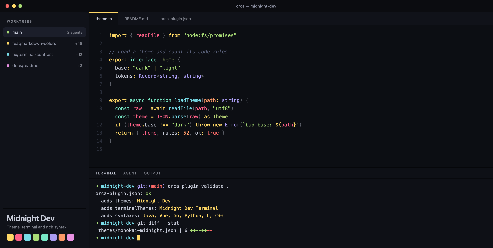

# Midnight Dev with Rich Syntax

A dark Monokai theme for [Orca](https://www.onorca.dev/): an app theme (interface and code colors), a matching terminal theme, and full TextMate grammars for **Java**, **Vue**, **Go**, **Python**, **C** and **C++**. The editor is darker than the sidebars. It is based on [Bearded Theme](https://github.com/BeardedBear/bearded-theme) **Monokai Reversed**, with darker backgrounds.



Requires Orca 1.4.246 or later.

## Use it

1. Install **Midnight Dev with Rich Syntax** from **Settings → Plugins** (community catalog).
2. In **Settings → Appearance**, choose **Midnight Dev** as the dark theme.
3. In **Settings → Terminal**, choose **Midnight Dev Terminal**.
4. Open a `.java`, `.vue`, `.go`, `.py`, `.c` or `.cpp` file. The plugin's grammars color it. See [Languages](#languages).
5. If another plugin also claims `.vue`, for example `gzimbron.vuejs-lang`, disable it. When two plugins claim the same file extension, Orca picks one by its syntax id.

To try a local copy, open **Settings → Plugins → Development folders…** and add this folder.

## Palette

| Role | Hex |
| --- | --- |
| Editor background | `#0c0e13` |
| Sidebar and tabs | `#101219` |
| Text | `#c6cad7` |
| Accent | `#98a2b5` |
| Yellow | `#ffd866` |
| Salmon | `#ff6188` |
| Blue | `#78dce8` |
| Green | `#a9dc76` |
| Turquoise | `#78e8c6` |
| Purple | `#ab9df2` |
| Orange | `#fc9867` |
| Pink | `#e991e3` |
| Red | `#fc6a67` |

Colors come from the built VS Code theme in Bearded Theme 10.1.0 (`bearded-theme-monokai-reversed.json`). All background surfaces are 15% darker in OKLCH lightness than in Bearded.

## Differences from Bearded

Orca needs opaque colors, 4.5:1 contrast for interface text and 3:1 for code colors. Only OKLCH lightness changes, as little as needed.

| Role | Bearded | Here |
| --- | --- | --- |
| Comment | `#4c526b` | `#5a617a` |
| Punctuation | `#c6cad7` at 40% | `#5f626b` |
| Muted interface text | `#c6cad7` at 50% | `#7e818b` |
| Sidebar text | `#a9aec1` at 80% | `#8c90a1` |
| Inactive tab text | `#4c526b` | `#757c97` |

Orca skips scope selectors that contain spaces, such as `source.diff markup.inserted.diff`, so those rules are left out. Simple scopes replace the Markdown and diff rules: headings yellow, inserted green, deleted red, changed blue (the Bearded color for modified files), and tables blue.

## Code colors in Orca

Orca reduces every code token to one of 24 token types before a theme colors it, so a theme in Orca has fewer color groups than in VS Code. Midnight Dev sets these types to the Bearded colors:

| Token type | Color | Examples |
| --- | --- | --- |
| Keywords and operators | yellow `#ffd866` | `public`, `import`, `if`, `=`, `+` |
| Names (identifiers) | text `#c6cad7` | variables, fields |
| Types | purple `#ab9df2` | `String`, `Order`, Vue components |
| Functions | blue `#78dce8` | `findById`, `useSeo` |
| Strings | green `#a9dc76` | `"text"` |
| Numbers | orange `#fc9867` | `42` |
| Objects, properties, `this` | orange `#fc9867` | `repository.`, `item.title` |
| Constants | red `#fc6a67` | `true`, `null` |
| Parameters, annotations | pink `#e991e3` | `@Component` |
| Regular expressions | turquoise `#78e8c6` | `/^a+$/` |
| Comments | slate italic `#5a617a` | `// note` |

Orca's built-in tokenizers for Java, Vue, Go, Python and C++ give every name the same token. This plugin replaces them with full TextMate grammars, so types, methods, objects and Vue directives get their own colors. In Vue files, component tags are purple, Tailwind class lists and `function`, `class` and `interface` are turquoise, and directive values have green quotes, as in Bearded. TypeScript and JavaScript files always keep Orca's built-in tokenizer.

## Languages

| Language | File extensions | Grammar source |
| --- | --- | --- |
| Java | `.java` | redhat-developer/vscode-java |
| Vue | `.vue` | vuejs/language-tools |
| Go | `.go` | worlpaker/go-syntax |
| Python | `.py` `.pyi` `.pyw` | MagicStack/MagicPython |
| C | `.c` | jeff-hykin/better-c-syntax |
| C++ | `.cpp` `.cc` `.cxx` `.c++` `.hpp` `.hh` `.hxx` `.h++` `.h` `.inl` `.ipp` `.tpp` | jeff-hykin/better-cpp-syntax |

`.h` files open as C++, as in VS Code. While the plugin is enabled, its grammars color these files with any theme. To get Orca's built-in tokenizers back, disable the plugin.

### Vue files

A `.vue` file uses five grammars: Vue, HTML for the template, TypeScript or JavaScript for `<script>`, and CSS or SCSS for `<style>`. The plugin includes all of them. The embedded TypeScript, JavaScript, CSS, SCSS and HTML grammars claim no file extensions, so they color only the blocks inside `.vue` files.

In VS Code, the Vue extension adds directives (`v-if`, `:prop`, `@event`) and `{{ }}` interpolation to HTML with injection grammars. Orca does not support injection grammars, so the plugin's HTML copy includes those Vue rules directly.

`<script lang="tsx">`, Less, Sass, Stylus, Pug, JSON and YAML blocks stay plain.

### Limits

- **TypeScript, JavaScript, JSON, CSS, SCSS, Less, HTML and Markdown** files keep Orca's own language, because it also gives completions and diagnostics. No plugin can replace their grammar.
- Orca stops coloring a file after a line longer than 1,000 characters, or a line that takes longer than 50 ms. Files over 500,000 characters or 20,000 lines stay plain.
- Inline assembly and GLSL inside C++ stay plain.
- Orca puts all punctuation into one token type, so HTML `<` `>` cannot be light blue as in Bearded.

### Update the grammars

```sh
./scripts/update-grammars.sh <vscode-commit-sha> <vue-language-tools-commit-sha>
orca plugin validate .
```

The script downloads the grammars and language configuration files from one exact commit of the VS Code repository and one exact commit of vuejs/language-tools. Without arguments, it uses the commits in `syntaxes/VSCODE_COMMIT` and `syntaxes/VUE_COMMIT`. Then it:

1. Converts the language configuration files to the strict JSON that Orca reads, and removes bracket pairs that are the same as the block comment markers.
2. Removes grammar references to rules that do not exist. VS Code ignores those references, but Orca refuses to load a grammar that has one.
3. Adds the Vue interpolation, directive and `class` list rules to the HTML copy.
4. Renames some scopes (`scripts/remap-scopes.py`). Orca reduces every grammar scope to one of 24 token types before a theme colors it, and a scope without a type falls back to Orca's built-in colors. For example, Java type names such as `String` are `storage.type.java`, and Orca reduces every `storage` scope to `keyword`. The script renames them to `support.type.java`, which Orca reduces to `type`, so types and keywords get different colors.

## What's new in 1.1.0

- New name: **Midnight Dev with Rich Syntax** (before: Monokai Midnight). The plugin id and theme ids do not change, so your settings stay.
- Full TextMate grammars for Java, Vue, Go, Python, C and C++.
- Colors for tabs, git status in the file explorer, the diff view, links, the current workspace row, split dividers and chat messages (23 new interface tokens).
- Code colors adjusted for Orca's token types: yellow keywords and operators, neutral names, orange objects and `this`, pink annotations, turquoise regular expressions.

## License

Midnight Dev is derived from [Bearded Theme](https://github.com/BeardedBear/bearded-theme) by BeardedBear, licensed under GPL-3.0. It is not an official Bearded Theme release. This theme is also licensed under GPL-3.0.

The grammars in `syntaxes/` keep their own licenses (MIT and the TextMate Bundle License). See [THIRD-PARTY-NOTICES.md](THIRD-PARTY-NOTICES.md).
